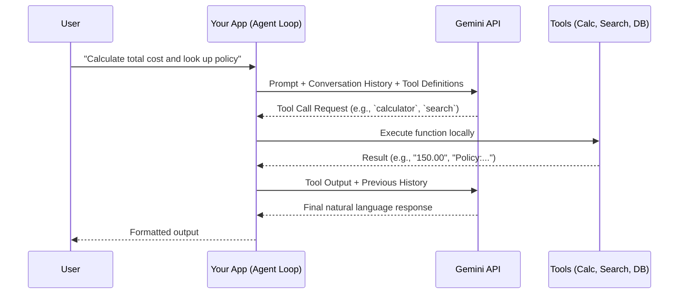

# Exercise 04: Multi-Tool Agent Engine

## 🎯 Goal
Understand and implement a generic Tool Calling Agent Engine. You will learn the critical concept that **the LLM does NOT execute tools; it only suggests them**. Your application code executes the tool and feeds the result back to the LLM.

## 🏗️ Architecture

## 🛠️ Instructions
1. Open `day2/04_tool_calling/starter.py`.
2. Implement the missing tool implementations (`calculator`, `search_knowledge_base`, `get_user_profile`).
3. Define the JSON Schema for the tools.
4. Implement the Agent Loop to parse tool requests, execute them, and feed results back.
5. Run the code and observe the execution trace.

## 🤔 Checkpoint Questions
- What happens if the tool execution fails? How should the LLM know?
- Why do we need a maximum iteration limit on the tool calling loop?
- How does the model know what arguments to provide to a tool?
