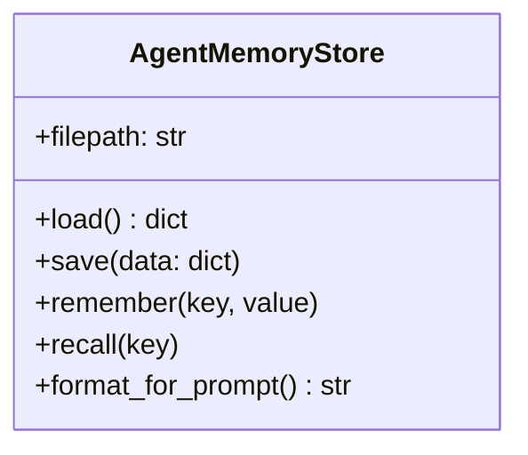

# Exercise 05: Persistent Session & Long-Term Memory Manager

## 🎯 Goal
Implement a memory system that allows your agent to remember information across sessions.

## 🏗️ Architecture

## 🛠️ Instructions
1. Open `day2/05_memory/starter.py`.
2. Implement the `AgentMemoryStore` class to read and write from a JSON file.
3. Build the CLI to allow storing and retrieving memories.
4. Integrate the memory context into the system prompt for the Gemini API call.

## 🤔 Checkpoint Questions
- What's the difference between Conversation History (Sliding Window) and Long-Term Memory?
- When should an agent autonomously decide to store a memory versus the user explicitly commanding it?
