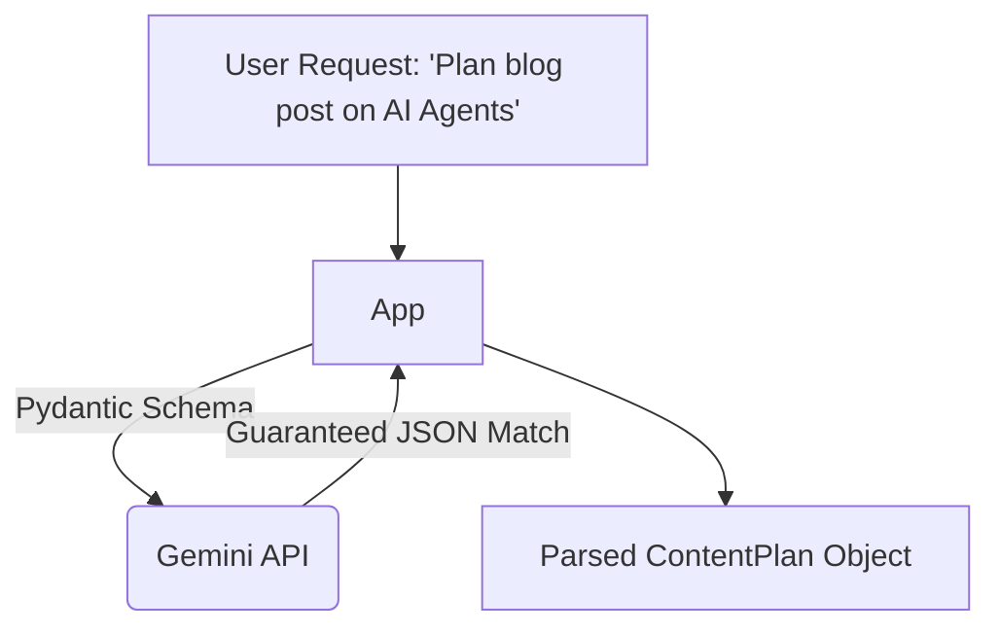

# Exercise 06: Production Structured Output Engine (Content Architect Case Study)

## 🎯 Goal
Guarantee that the LLM responds in a strictly typed JSON format using Pydantic and the `response_format` JSON schema mode.

## 🏗️ Architecture

## 🛠️ Instructions
1. Open `day2/06_generator/starter.py`.
2. Define the Pydantic model `ContentPlan`.
3. Pass `response_format` using `MyPydanticModel.model_json_schema()`.
4. Parse the raw JSON string back into the Pydantic object and print it nicely.

## 🤔 Checkpoint Questions
- Why is Structured Output better than just prompting "Return JSON"?
- What happens if the model cannot fulfill the schema requirements?
