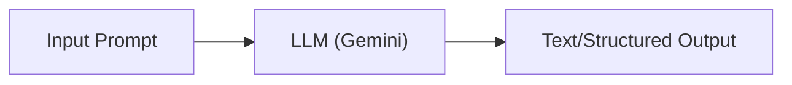
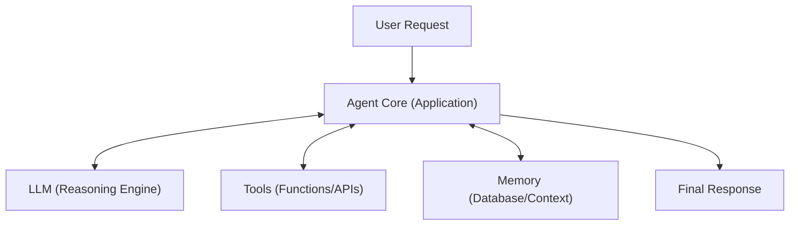
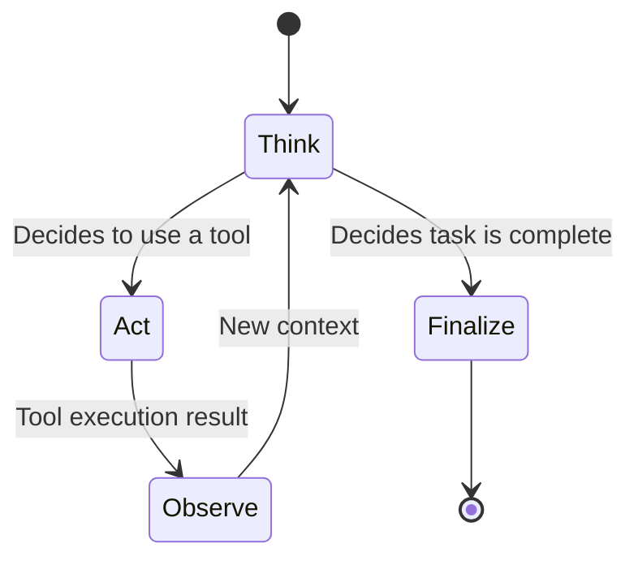
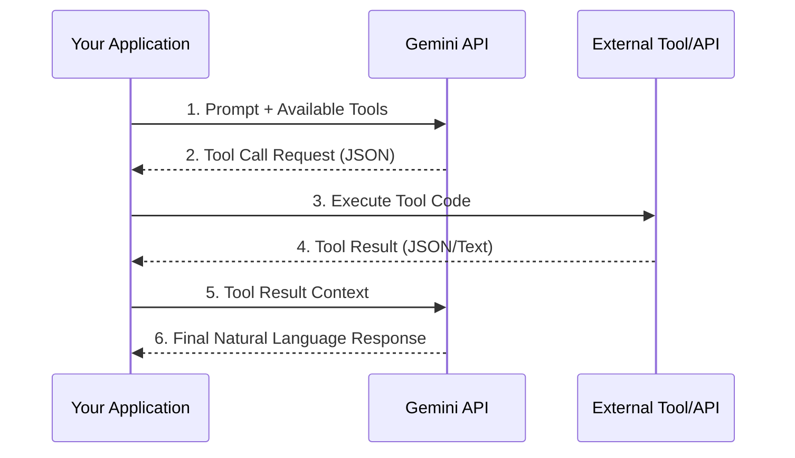
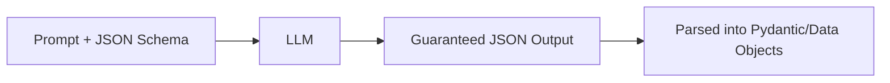

# Core Concepts in AI Agent Architecture

This guide covers the fundamental concepts of building AI agents using large language models (LLMs) like Gemini.

## 1. What is an LLM?

A Large Language Model (LLM) is an advanced autocomplete engine. It predicts the most likely next tokens (words/pieces of words) based on a massive amount of training data and the context provided in the prompt.

**Key Insight:** LLMs are stateless. They don't "remember" past interactions unless you explicitly provide that history in every new prompt.

## 2. What is an Agent?

An Agent is an LLM wrapped in a software system that can:
1. **Perceive:** Take in context (messages, sensors, API data).
2. **Reason:** Decide what to do next (via prompt engineering).
3. **Act:** Use tools to interact with the world (calling functions, making API requests).

## 3. The Agent Loop (ReAct Pattern)

The core pattern for many agents is **Reason + Act (ReAct)**. The agent receives a task, thinks about it, decides to use a tool, uses it, observes the result, and repeats until the task is complete.

## 4. Tool Execution: Who actually runs the code?

**Common Misconception:** "The LLM executes the tool."
**Reality:** The LLM only *requests* that a tool be run by generating JSON. Your application code executes the actual function and passes the result back to the LLM.

## 5. Memory vs. Knowledge

- **Memory (Context Window):** The active conversation history passed to the LLM in the current request. Limited by context size (though Gemini supports massive context windows). It is stored data (lists, databases), not "consciousness."
- **Knowledge (RAG):** External information (documents, databases) retrieved *before* calling the LLM and injected into the prompt.

## 6. Structured Output

Instead of getting unpredictable text, you can force the LLM to output data in a specific format (like JSON matching a Pydantic schema). This is crucial for integrating LLMs into robust software pipelines.

